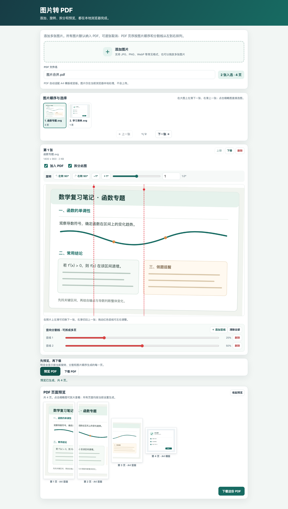

# 图片转 PDF 小工具

在线使用：[打开图片转 PDF](https://image-to-pdf-tool-20261108.elegantcarp.chatgpt.site/)

把多张照片整理成一份 PDF。可以调整图片顺序、旋转角度、用竖线切分长图，并在下载前预览每一页。

*截图使用虚构的演示图片。*

## 使用方法

1. **添加图片**：点“添加图片”选择多张 JPG、PNG、WebP 等图片，也可以把图片拖入页面。
2. **调整顺序和选择**：用图片缩略图切换当前图片；在大图上左滑切到下一张、右滑回到上一张。使用图片旁的上移、下移按钮调整 PDF 页序，也可以取消“加入 PDF”。
3. **旋转或拆分**：用 90° 按钮快速旋转；用 −1° / +1° 微调，或拖动角度滑块以 0.1° 为步进调整。勾选“拆分此图”后，可以拖动红色竖线、调整下方滑块位置，或添加多条竖线。切分后的页面按从左到右排列。
4. **预览和下载**：设置 PDF 文件名，点击“预览 PDF”检查页面；确认顺序和切分效果后，点击“下载 PDF”。页面会按内容自动选择 A4 纵向或横向。

## 隐私说明

图片只在访问者自己的浏览器中处理，不会上传到网站服务器。生成的 PDF 由浏览器直接下载到本地设备。

## 本地使用

下载仓库后，直接用浏览器打开根目录中的 `index.html` 即可，无需安装依赖。
